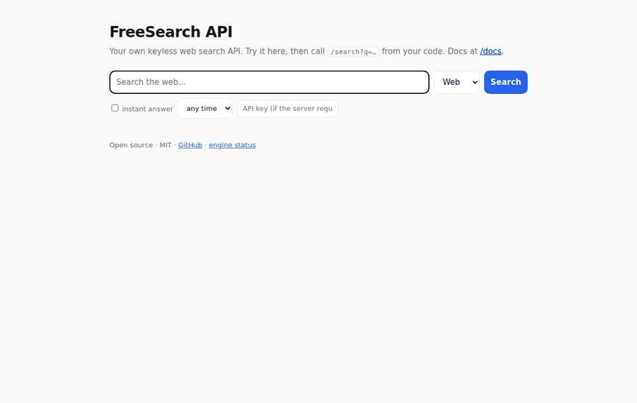
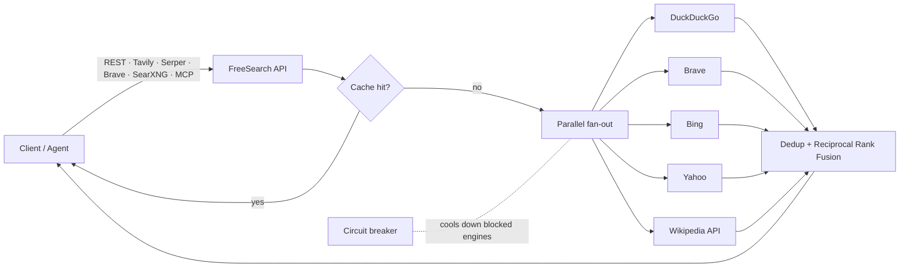

<div align="center">

# 🔎 FreeSearch API


**Your own web search API. Free forever, no API keys, no quotas.**

Self-hosted metasearch that queries DuckDuckGo, Brave, Bing, Yahoo, Wikipedia, and news feeds in parallel and merges the results into one clean JSON API.<br>
It works as a **drop-in replacement for Tavily, Serper, the Brave Search API, and SearXNG**, and ships with an **MCP server** for Claude, Cursor and other AI agents.

[](https://github.com/Ethos6/free-search-api/actions/workflows/ci.yml)
[](https://github.com/Ethos6/free-search-api/releases)
[](https://github.com/Ethos6/free-search-api/actions/workflows/live.yml)
[](LICENSE)


[Quick start](#-quick-start) · [API](#-api) · [Drop-in replacements](#-drop-in-replacement-for-paid-search-apis) · [MCP](#-mcp-server-claude-cursor-windsurf) · [Config](#%EF%B8%8F-configuration) · [How it works](#-how-it-works) · [FAQ](#-faq)



<sub>Recorded automatically by the <a href="https://github.com/Ethos6/free-search-api/actions/workflows/demo.yml">Demo GIF workflow</a>: a real search against live engines from a GitHub runner.</sub>

</div>

---

## Why?

AI agents, RAG pipelines and scripts all need web search, and every search API charges per query:

| | Price | Limits | Self-hosted | Open source |
|---|---|---|---|---|
| Tavily | paid after free credits | monthly credits | ❌ | ❌ |
| Serper / SerpAPI | paid per 1k queries | monthly credits | ❌ | ❌ |
| Brave Search API | paid plans | monthly cap | ❌ | ❌ |
| SearXNG | free | you run it | ✅ | ✅ (AGPL) |
| **FreeSearch API** | **free** | **none imposed by the software** | ✅ | ✅ **MIT** |

FreeSearch speaks the same request and response formats as the paid APIs, so you change one base URL and keep your code.

## ✨ Features

- **No API keys anywhere.** It queries public search pages and official public APIs. There's nothing to sign up for.
- **Several engines at once.** Queries run in parallel and the results are merged with [Reciprocal Rank Fusion](https://plg.uwaterloo.ca/~gvcormac/cormacksigir09-rrf.pdf), so a page that several engines rank highly comes first. Duplicates are removed, including `www.`, tracking-parameter and trailing-slash variants.
- **Fast.** Plain async HTTP with no headless browser, so a typical search takes well under a second. `mode=fast` returns as soon as one engine has enough results.
- **Resilient.** Each engine has a circuit breaker. An engine that rate-limits or shows a CAPTCHA cools down automatically while the others keep answering, and one failing engine never breaks a search.
- **Hard to block.** [curl_cffi](https://github.com/lexiforest/curl_cffi) copies real browser TLS/HTTP2 fingerprints, and you can rotate proxies (HTTP/SOCKS5/Tor) round-robin.
- **News search** from the Bing News and Google News RSS feeds, with source and publish date.
- **Page extraction.** `/extract` turns any URL into clean Markdown with [trafilatura](https://github.com/adbar/trafilatura), ready for LLMs. It includes SSRF protection.
- **Instant answers** from the DuckDuckGo Instant Answer API, with a Wikipedia summary as fallback.
- **Caching.** An in-memory LRU cache by default, or Redis for multi-worker setups.
- **Optional API keys and rate limiting** for when you expose the server publicly.
- **Built-in web UI** at `/` and interactive OpenAPI docs at `/docs`.
- **Several ways to use it:** a REST API, an MCP server, a CLI, or a Python library.

## 🚀 Quick start

**Docker, one command**

```bash
docker run -d -p 8000:8000 ghcr.io/ethos6/free-search-api:latest
curl "http://localhost:8000/search?q=hello+world"     # or open http://localhost:8000
```

**Docker Compose (with a Redis cache)**

```bash
git clone https://github.com/Ethos6/free-search-api && cd free-search-api
docker compose up -d          # API + Redis cache on http://localhost:8000
curl "http://localhost:8000/search?q=hello+world"
```

**pip**

```bash
pip install "free-search-api[mcp] @ git+https://github.com/Ethos6/free-search-api"
freesearch serve              # http://localhost:8000  (docs at /docs)
```

**CLI, no server needed**

```bash
freesearch search "best rust web framework" -n 5
freesearch news "open source ai" -t week
freesearch extract https://en.wikipedia.org/wiki/Web_search_engine
```

**Python library**

```python
import freesearch

res = freesearch.search("python asyncio tutorial", max_results=5)
for r in res.results:
    print(r.title, r.url, r.engines)
```

There's an async version too: `async with FreeSearch() as fs: await fs.search(...)`. See [`examples/`](examples).

## 📡 API

### `GET /search`

```bash
curl "http://localhost:8000/search?q=fastapi+tutorial&max_results=5&include_answer=true"
```

| Param | Default | Description |
|---|---|---|
| `q` | required | Search query |
| `max_results` | `10` | 1–50 |
| `page` | `1` | 1–10 |
| `region` | `us-en` | `<country>-<lang>`, e.g. `in-en`, `de-de`, `fr-fr` |
| `safesearch` | `moderate` | `off` · `moderate` · `strict` |
| `time_range` | – | `day` · `week` · `month` · `year` |
| `engines` | server default | e.g. `duckduckgo,brave` |
| `mode` | `full` | `full` merges every engine; `fast` returns the first engine with enough results |
| `include_answer` | `false` | Add an instant answer |
| `include_raw_content` | `false` | Fetch every result page and include its content as Markdown |
| `include_domains` / `exclude_domains` | – | Comma-separated domain filters |

```jsonc
{
  "query": "fastapi tutorial",
  "answer": "FastAPI is a modern web framework for building APIs with Python…",
  "results": [
    {
      "title": "Tutorial - User Guide - FastAPI",
      "url": "https://fastapi.tiangolo.com/tutorial/",
      "content": "This tutorial shows you how to use FastAPI with most of its features, step by step…",
      "engine": "duckduckgo",
      "engines": ["duckduckgo", "brave", "bing", "yahoo"],
      "score": 1.0,
      "position": 1,
      "published_date": null
    }
  ],
  "number_of_results": 5,
  "engines": [{ "name": "duckduckgo", "ok": true, "results": 10, "elapsed_ms": 412 }, "…"],
  "cached": false,
  "response_time": 0.61
}
```

`POST /search` takes the same fields as JSON.

### Other endpoints

| Endpoint | What it does |
|---|---|
| `GET /news?q=` | News articles with `source` and `published_date` |
| `GET /extract?url=` · `POST /extract {"urls": [...]}` | Page content as Markdown (up to 20 URLs) |
| `GET /engines` | Engine list with live health: success rate, latency, cooldown |
| `GET /health` | Liveness probe |
| `GET /docs` | Interactive OpenAPI docs |
| `GET /` | Web search UI |

## 🔁 Drop-in replacement for paid search APIs

Point your existing client at your server. Any API key value works unless you've set `FREESEARCH_API_KEYS`.

| You use | Change the base URL to | Endpoints |
|---|---|---|
| **Tavily** | `http://localhost:8000/tavily` | `POST /search`, `POST /extract` |
| **Serper** | `http://localhost:8000/serper` | `POST /search`, `POST /news` |
| **Brave Search API** | `http://localhost:8000/brave` | `GET /res/v1/web/search` |
| **SearXNG** (Open WebUI, Perplexica, LibreChat…) | `http://localhost:8000/searxng` | `GET /search?format=json` |

```python
from tavily import TavilyClient

client = TavilyClient(api_key="unused", api_base_url="http://localhost:8000/tavily")
client.search("latest python release", include_answer=True)
```

**Open WebUI:** go to *Admin → Settings → Web Search*, choose **SearXNG**, and set the query URL to `http://<host>:8000/searxng/search?q=<query>`.

## 🤖 MCP server (Claude, Cursor, Windsurf)

This gives your AI assistant free `web_search`, `news_search` and `read_page` tools.

```bash
pip install "free-search-api[mcp] @ git+https://github.com/Ethos6/free-search-api"
```

Add this to `claude_desktop_config.json` (or the MCP settings in Cursor or Windsurf):

```json
{
  "mcpServers": {
    "freesearch": { "command": "freesearch", "args": ["mcp"] }
  }
}
```

For remote agents, `freesearch mcp --transport streamable-http --port 8001` serves MCP over HTTP at `/mcp`.

## ⚙️ Configuration

Set these as environment variables or in a `.env` file. See [`.env.example`](.env.example).

| Variable | Default | Description |
|---|---|---|
| `FREESEARCH_ENGINES` | `duckduckgo,brave,bing,yahoo,wikipedia` | Default web engines |
| `FREESEARCH_NEWS_ENGINES` | `bing_news,google_news` | Default news engines |
| `FREESEARCH_TIMEOUT` | `6` | Per-engine timeout in seconds |
| `FREESEARCH_API_KEYS` | – | Comma-separated keys. Empty means no auth |
| `FREESEARCH_RATE_LIMIT` | `0` | Requests per minute per key or IP. `0` means unlimited |
| `FREESEARCH_PROXIES` | – | `http://…,socks5h://…` rotated round-robin |
| `FREESEARCH_CACHE_TTL` | `3600` | Cache lifetime in seconds. `0` disables the cache |
| `FREESEARCH_REDIS_URL` | – | Use Redis instead of the in-memory cache |
| `FREESEARCH_SEARXNG_URL` | – | Add your own SearXNG instance as an engine |
| `FREESEARCH_CORS_ORIGINS` | `*` | Allowed CORS origins |

Clients can send API keys as `Authorization: Bearer <key>`, `X-API-Key`, `X-Subscription-Token` (Brave), `?api_key=`, or `api_key` in the JSON body (Tavily).

## 🧠 How it works



### Engines

| Engine | Type | Default | Notes |
|---|---|---|---|
| `duckduckgo` | web | ✅ | HTML endpoint |
| `brave` | web | ✅ | Independent index |
| `bing` | web | ✅ | |
| `yahoo` | web | ✅ | |
| `wikipedia` | web | ✅ | Official MediaWiki API |
| `mojeek` | web | opt-in | Independent index, strict CAPTCHA |
| `google` | web | opt-in | Experimental, works best with proxies |
| `searxng` | web/news | when `FREESEARCH_SEARXNG_URL` is set | Your SearXNG instance |
| `bing_news` | news | ✅ | RSS |
| `google_news` | news | ✅ | RSS |

Adding an engine takes about 30 lines: subclass `Engine`, implement `build()` and `parse()`, and register it in [`freesearch/engines/__init__.py`](freesearch/engines/__init__.py). PRs are welcome.

## ♾️ What "unlimited" means

FreeSearch puts no quotas, credits or paywalls on you. The upstream engines still protect themselves per IP address, so if one IP sends thousands of queries a minute, some engines will start returning CAPTCHAs. FreeSearch is built to handle that:

1. **Caching.** Repeated queries never reach the engines.
2. **Failover.** A blocked engine cools down and the others keep answering.
3. **Spreading load.** Several engines share the traffic.
4. **Proxies.** Set `FREESEARCH_PROXIES`, or uncomment Tor in `docker-compose.yml`, to spread traffic across IPs.

Home servers and residential IPs get blocked far less than cloud IPs. The [live engine check](https://github.com/Ethos6/free-search-api/actions/workflows/live.yml) runs every day from a GitHub runner (a datacenter IP) and posts a health table in its job summary.

## ☁️ Deploy

- **Any VPS or home server:** `docker compose up -d`
- **Render:** `render.yaml` is included. Create a new Blueprint from this repo; it generates an API key for you.
- **Railway, Fly.io, Koyeb, Google Cloud Run:** deploy the `Dockerfile`. It reads `$PORT`.

When you expose the server to the internet, set `FREESEARCH_API_KEYS`.

## ❓ FAQ

**Is this legal?** FreeSearch is a tool. It sends ordinary search requests the way a browser does, at human-scale volume. Automated querying may conflict with some search engines' terms of service, so you're responsible for how you use and deploy it. For heavy commercial use, consider the engines' official APIs.

**Why not just use SearXNG?** SearXNG is great. FreeSearch is smaller and API-first: it's MIT-licensed, ships with compatible endpoints for the major paid APIs, an MCP server and page extraction, and its JSON API is on by default. It can also use your SearXNG instance as one of its engines.

**Can I use it in production?** Yes. Run several workers with Redis caching and API keys, and add proxies if you have high volume.

## 🛠 Development

```bash
pip install -e ".[dev]"
pytest              # unit tests (offline, fixture-based)
pytest -m live -v   # real searches
ruff check .
```

## 🤝 Contributing

Issues and PRs are welcome, especially new engines, parser fixes when an engine changes its HTML, and more compatible endpoints. Each engine's parser has a fixture test in `tests/`.

## 📄 License

[MIT](LICENSE). Use it for anything.

If FreeSearch saves you money, **please ⭐ star the repo** so more people can find it.
